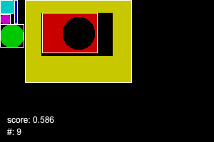
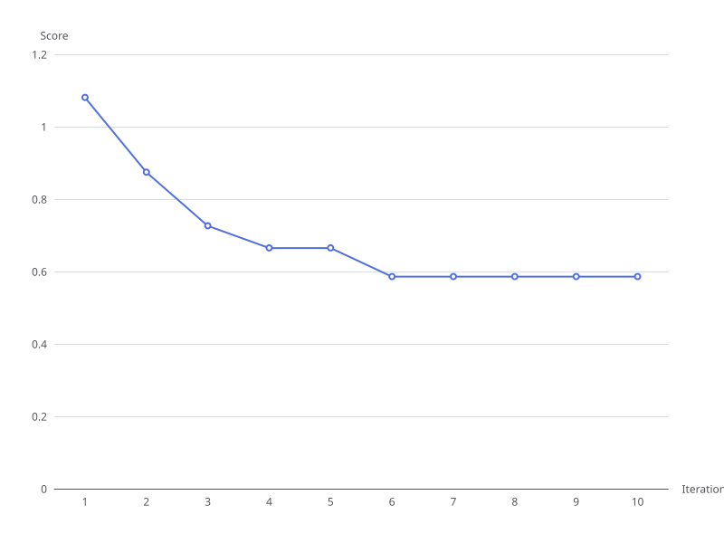

# FaWaMi: Fabric waste minimization project

This project implements a genetic algorithm from scratch to optimize the placement of sewing pattern pieces on fabric, minimizing the textile waste. The software is definitely not competitive with existing solutions in terms of running time or final packing, but the modular architecture provides a flexible tool for testing alternative fitness functions, crossover operators, and mutation strategies.

## Documentation

You can read the official report of the project here: [results/PatinyOceane_rapport_MSE_PA_SA25.pdf](results/PatinyOceane_rapport_MSE_PA_SA25.pdf)

## Results

When running the demo, a complete results folder is generated, which contains images of the pieces layout on the fabric after each generation (in `bestGenes`) and heatmaps of the similarity of the individual (to ensure that there is enough diversity for efficient crossover, this is in `heatmaps`). A convergence plot of the solution score at each generation is also saved as `convergencePlot.svg`. Finally, all of the configuration used during the optimization is stored in `config.json`, whereas statistics are computed and savec in `results.json`.

An example of a results folder can be found in [results/2026-01-06-seed1](results/2026-01-06-seed1).

In that example, which uses simple small geometric shapes, the final optimized placement after ten iteration shown in the following image. The packing for this placement of the pieces is 73%.

Whereas the corresponding convergence plot is shown below.

## Run the demo

Make sure you have `node` and `npm` installed. Download all packages with `npm i`, then run the demo script: `node demo/index.ts`

To run the demo in watch mode: `node --watch demo/index.ts`

## Key Features

- **Rectangular fabric support**: Designed for rectangular fabric pieces only
- **SVG input:** Automatically extracts pattern pieces from SVG files and removes text annotations
- **Flexible resolution:** User-defined discretization in pixels per centimeter
- **Cardinal rotations:** Handles 0°, 90°, 180°, and 270° piece orientations
- **Holes:** Supports pieces with holes and enables recursive nesting
- **No shape restrictions:** Raster model accepts any shape (curved, concave, etc.)

## How It Works

The algorithm represents each solution as a "gene" encoding the position (row, column) and orientation of each pattern piece. A fitness function evaluates solutions based on the weighted sum of five parameters:

- Number of overlapping pixels
- Fabric length used
- Pieces average row
- Pieces average column
- Packing (fraction of fabric used)

Through iterative cycles of mutation (translation of pieces) and crossover (combining parent solutions), the population evolves toward better layouts. The population is composed of both elite individuals (highest fitness) and diverse individuals (maximum variety).

## Implementation

Built with Node.js and TypeScript, using the [`image-js`](https://github.com/image-js/image-js) library for image processing. All the code is published under MIT license.

## Project structure

- `data`: SVG patterns, which are either simple geometric shapes, or actual sewing patterns exported from [FreeSewing](https://freesewing.eu/)
- `demo`: Contains example scripts that import the functions defined in `src`. The main demo script is `index.ts`.
- `docs`: Various notes, technical tips and a lab notebook.
- `src`: Contains the actual code. Most of the functions are unit tested using Vitest.
- `test`: Additional code to enable image specific matchers (for unit tests)

## Running the unit tests

- Watch mode: `npx vitest` (no coverage)
- Focus on one test: `npx vitest testName`
